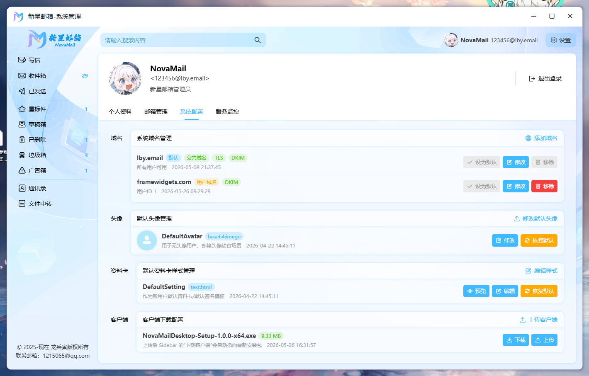
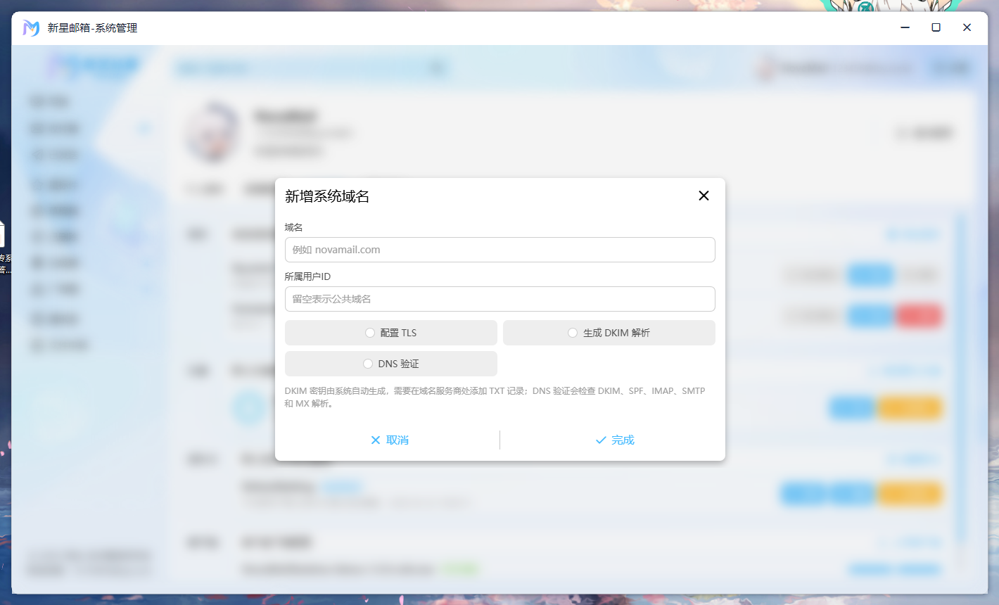
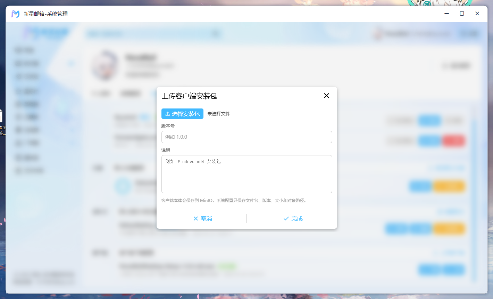
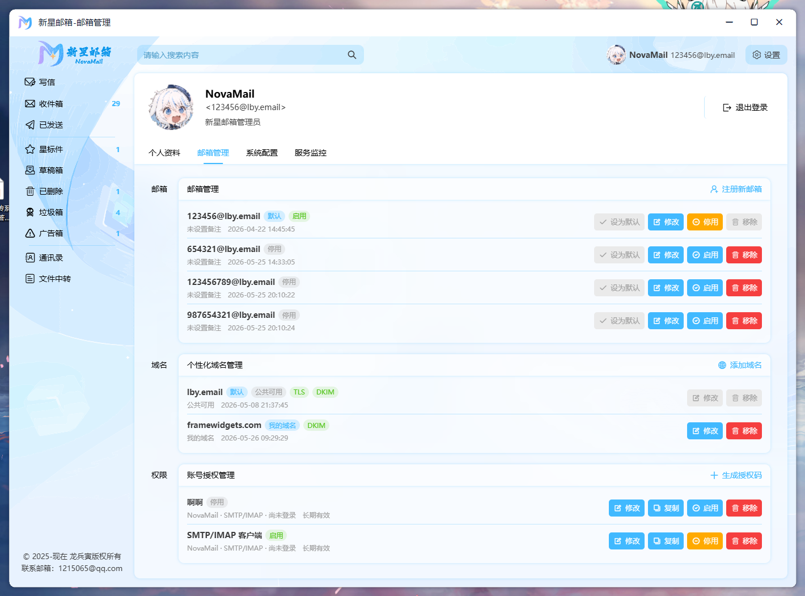
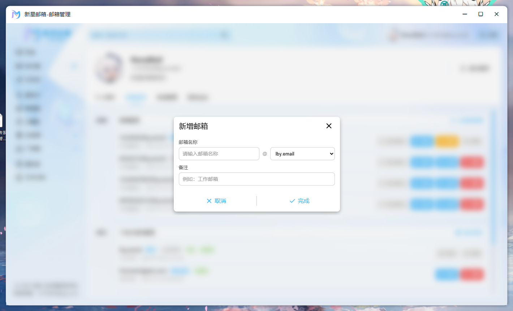

# NovaMail

NovaMail 是一个完整的邮件系统毕业设计项目，覆盖 Web 前端、Java 应用服务、C++ 邮件协议服务、Windows 桌面客户端以及基于 BERT/ONNX 的邮件智能分类模块。

项目目标是实现一套可以自主管理用户、域名、邮箱、邮件、附件和服务状态的邮件平台，并提供浏览器端和 Windows 桌面端两种使用方式。

## 功能概览

- 用户注册、登录、JWT 鉴权、访问令牌刷新、图形验证码和短信验证码。
- 邮箱管理、默认邮箱、邮箱授权码、域名管理、DNS 校验、DKIM/TLS 配置。
- 邮件收发、草稿箱、收件箱、已发送、星标、已删除、垃圾邮件、广告邮件、已读/未读状态和附件预览/下载。
- 通讯录、联系人分组、用户资料、头像、签名、用户文件空间。
- WebSocket 邮件通知和系统服务监控。
- SMTP、IMAP、服务注册中心 LikeHub、邮件智能分类等独立 C++ 服务。
- Windows WebView2 桌面壳与 Inno Setup 安装包构建。

## 技术栈

| 模块 | 技术 |
| --- | --- |
| 前端 | Vue 3、TypeScript、Vite、Vue Router、Pinia、Element Plus、Axios、TinyMCE/CKEditor |
| 应用服务 | Java 17、Spring Boot 3、MyBatis Plus、MySQL、Redis、MinIO、JWT、WebSocket、SpringDoc OpenAPI |
| 邮件服务 | C++20、Makefile、g++-11、OpenSSL、libcurl、MySQL Connector/C++ X DevAPI、AWS S3 SDK、ONNX Runtime |
| 桌面客户端 | Visual Studio 2022、C++17、WebView2、Windows Resource、Inno Setup 6 |
| 智能分类 | Python 训练脚本、BERT、ONNX Runtime |

## 目录结构

```text
NovaMail
├── BertMailClass/        邮件分类模型训练与推理脚本
├── Databases/            MySQL 数据库初始化脚本
├── NovaMailDesktop/      Windows WebView2 桌面客户端
├── NovaMailServers/      C++ 邮件基础服务
│   ├── Classification/   邮件智能分类服务
│   ├── Imap/             IMAP 服务
│   ├── LikeHub/          服务注册与调用中心
│   └── Smtp/             SMTP 服务
├── NovaMailService/      Spring Boot 应用服务
└── novamail-ui/          Vue 前端项目
```

## 环境要求

- JDK 17
- Maven 3.8+
- Node.js 20+ 和 npm
- MySQL 8，C++ 服务需要启用 MySQL X Plugin，默认使用 `33060`
- Redis
- MinIO 或兼容 S3 的对象存储服务
- Linux 构建环境：`make`、`g++-11`、`openssl`、`libcurl`、`zlib` 等
- Windows 桌面端构建环境：Visual Studio 2022、WebView2 Runtime、Inno Setup 6

## 数据库初始化

将数据库脚本导入 MySQL：

```bash
mysql -u root -p < Databases/NovaMail.sql
```

脚本包含默认数据，但不包含默认域名数据。默认管理员账号：

```text
账号：NovaMail
密码：Lby180607230.
```

## 配置说明

后端主配置位于：

```text
NovaMailService/src/main/resources/application.yml
```

部署或本地运行前需要重点检查：

- `spring.datasource`：MySQL JDBC 地址、账号和密码。
- `spring.data.redis`：Redis 地址、端口、密码和数据库编号。
- `minio`：对象存储地址、Access Key 和 Secret Key。
- `hub-server`：Java 应用服务连接 LikeHub 的地址、端口和认证信息。
- `mail.dns-verification`：域名 DNS 校验期望值，如 IMAP A、SMTP A、MX、SPF。
- `ip-region.local-path`：IP 数据库文件路径，建议改成当前机器可访问的绝对路径。

C++ 服务配置分别位于：

```text
NovaMailServers/LikeHub/Configuration.json
NovaMailServers/Smtp/Configuration.json
NovaMailServers/Imap/Configuration.json
NovaMailServers/Classification/Configuration.json
```

需要重点保持以下配置一致：

- `LikeHub.server.port` 与其他服务的 `hubServer.port` 一致。
- `hubServer.access`、`hubServer.secret` 与 LikeHub 的 `authentication.access`、`authentication.secret` 一致。
- Java 后端的 `hub-server.port` 与实际部署的 LikeHub 端口一致。
- MySQL、MinIO、SMTP/IMAP 域名和端口按部署环境调整。

注意：仓库中的配置适合开发调试参考，生产环境请更换数据库密码、JWT 密钥、短信密钥、对象存储密钥和服务认证密钥，不要直接使用示例值。

## 首次启动配置

数据库初始化脚本不包含默认域名数据，因此系统首次启动完成后，管理员需要先进入系统管理界面完成基础配置，否则无法正常注册邮箱和完成邮件收发。

建议按以下顺序配置：

1. 登录默认管理员账号，进入 `设置 -> 系统配置`。
2. 在域名管理中添加系统域名，填写域名和所属用户 ID。公共域名可将所属用户 ID 留空，个人域名需要绑定对应用户。
3. 为域名完成 TLS 配置，并查看系统生成的 DKIM 解析记录。
4. 到域名 DNS 服务商处添加并等待解析生效：
   - DKIM TXT 记录。
   - 根域 SPF TXT 记录。
   - `imap` A 记录。
   - `smtp` A 记录。
   - 根域 MX 记录。
5. 回到系统配置中执行 DNS 验证，确认 DKIM、SPF、IMAP、SMTP、MX 均验证通过。
6. 在系统配置的客户端下载配置中上传 Windows 桌面端安装包，使侧边栏“下载客户端”能够指向最新安装包。
7. 进入 `设置 -> 邮箱管理`，为管理员手动注册邮箱，并按需设置为默认邮箱和启用状态。

注意：由于初始化时没有域名，管理员账号不会自动拥有可用邮箱，需要在域名添加并验证完成后手动注册管理员邮箱。

系统配置总览示例：



域名 TLS、DKIM、DNS 验证示例：



上传 Windows 客户端安装包示例：



邮箱与授权码管理示例：



管理员手动注册邮箱示例：



## 启动后端服务

进入 Spring Boot 项目：

```bash
cd NovaMailService
```

开发阶段推荐直接在 IDE 中运行：

```text
com.example.novamailservice.NovaMailServiceApplication
```

也可以使用 Maven：

```bash
mvn -Dspring-boot.run.skip=false spring-boot:run
```

默认端口为：

```text
http://127.0.0.1:9099
```

接口文档地址：

```text
http://127.0.0.1:9099/swagger-ui/index.html
```

## 启动前端

进入前端项目：

```bash
cd novamail-ui
npm install
npm run dev
```

默认访问地址：

```text
http://127.0.0.1:3000
```

前端接口地址目前在 `novamail-ui/src/utils/Request.ts` 中配置，默认连接：

```text
HTTP: http://127.0.0.1:9099
WS:   ws://127.0.0.1:9099
```

如后端部署在其他地址，需要同步修改该文件或后续改造成环境变量配置。

构建生产包：

```bash
npm run build
```

## 编译和运行 C++ 邮件服务

`NovaMailServers` 需要在 Linux 环境中编译，不支持直接在 Windows 下编译。进入目录：

```bash
cd NovaMailServers
make all
```

生成结果位于各子模块的 `bin/` 目录，部分公共库会安装到 `NovaMailServers/lib/`。

推荐启动顺序：

```bash
make run-LikeHub
make run-Smtp
make run-Imap
make run-Classification
```

也可以进入子目录单独构建和运行：

```bash
cd NovaMailServers/Smtp
make all
make run
```

常用默认端口：

| 服务 | 默认端口 | 说明 |
| --- | --- | --- |
| LikeHub | 2525 或部署配置中的端口 | 服务注册与调用中心 |
| SMTP | 25 | 低端口，通常需要 root 权限或修改端口 |
| IMAP | 143 | 低端口，通常需要 root 权限或修改端口 |
| Classification | 无固定公网端口 | 通过 LikeHub 注册调用 |

生成 `compile_commands.json` 需要安装 `bear`：

```bash
make build
```

## Windows 桌面客户端

桌面客户端位于 `NovaMailDesktop`，使用 Visual Studio 2022 打开：

```text
NovaMailDesktop/NovaMailDesktop.sln
```

推荐使用 `Release | x64` 构建。

如果需要把 Vue 前端打进桌面客户端资源，先构建前端：

```bash
cd novamail-ui
npm run build
```

然后打包前端资源到桌面端工程：

```bash
cd ../NovaMailDesktop
node tools/pack-vue-dist.mjs ../novamail-ui/dist NovaMailDesktop/res/vue-dist
```

完成后再使用 Visual Studio 构建桌面端。

安装包依赖 Inno Setup 6。先构建出 `NovaMailDesktop/x64/Release/NovaMailDesktop.exe`，再执行：

```powershell
cd NovaMailDesktop
.\tools\build-installer.ps1 -Version 1.0.0
```

安装包输出目录：

```text
NovaMailDesktop/dist/installer
```

## 邮件分类模型

训练和推理脚本位于：

```text
BertMailClass/training
├── EmailProcess.py
├── InferMail.py
└── TrainBert.py
```

由于训练数据体积较大，仓库不随附完整训练数据。需要重新训练时，请自行准备数据集并运行 `TrainBert.py`。完成后将 ONNX 模型、词表和标签映射放到 `NovaMailServers/Classification/Configuration.json` 中配置的 `models` 路径。

## 常用命令

```bash
# 前端开发
cd novamail-ui
npm run dev

# 前端构建
cd novamail-ui
npm run build

# 后端测试
cd NovaMailService
mvn test

# C++ 服务构建
cd NovaMailServers
make all

# C++ 服务清理
cd NovaMailServers
make clean
```

## 端口速查

| 端口 | 模块 | 用途 |
| --- | --- | --- |
| 3000 | novamail-ui | Vite 开发服务器 |
| 9099 | NovaMailService | Spring Boot HTTP/WebSocket 服务 |
| 25 | Smtp | SMTP 服务 |
| 143 | Imap | IMAP 服务 |
| 2525/19090 | LikeHub | 服务注册中心，按实际配置为准 |
| 3306 | MySQL | Java 后端 JDBC 连接 |
| 33060 | MySQL X Plugin | C++ 服务 MySQL X DevAPI 连接 |
| 9000 | MinIO | 对象存储 API |

## 开发注意事项

- 低端口如 `25`、`143` 在 Linux 上通常需要 `sudo`，也可以在对应 `Configuration.json` 中改成高端口调试。
- 经测试，阿里云服务器默认禁止 `25` 端口外发，部署 SMTP 外发能力时需要申请解封或改用服务商允许的邮件投递端口。
- 经测试，阿里云环境下 `143` 端口无法从普通 Socket 平滑提升为 TLS 连接；需要申请解除。
- `Configuration.json` 和 `application.yml` 中的地址、密钥、密码需要根据本地或服务器环境调整。
- 前端默认写死连接 `127.0.0.1:9099`，联调远程后端前需要修改请求配置。
- C++ 分类服务依赖 `libonnxruntime.so.1`，构建时会从 `NovaMailServers/lib/` 复制到分类服务 `bin/` 目录。
- Windows 桌面端依赖 WebView2 Runtime；打包安装包前请确认 Release 目录中存在 `NovaMailDesktop.exe` 和 `WebView2Loader.dll`。
- 生产部署前请重新生成 JWT 密钥，替换所有示例凭据，并限制 LikeHub 白名单。
